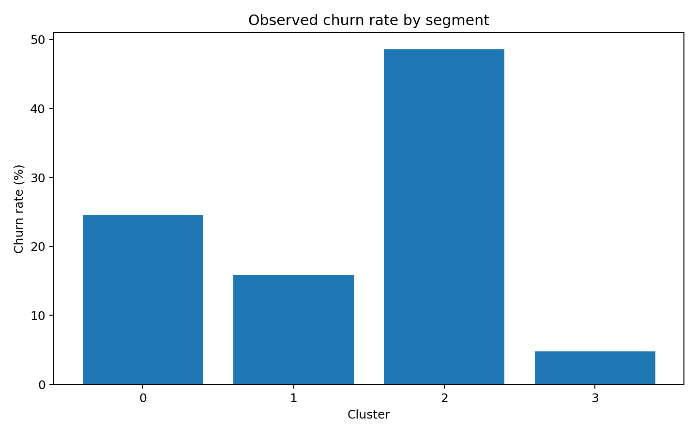
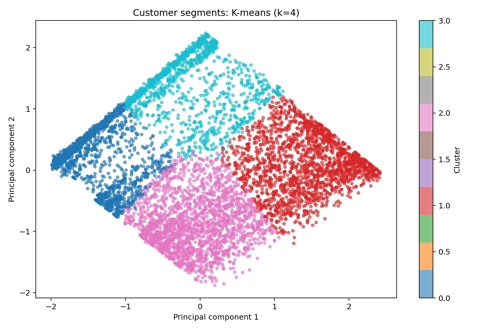
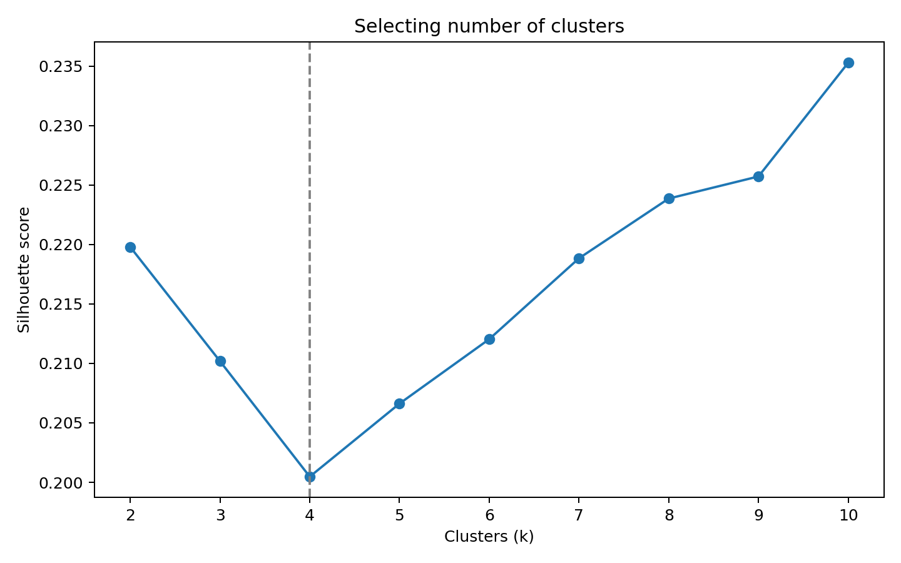

# Telecommunications Customer Segmentation — K-means Clustering

**Portfolio project | Python • Pandas • Scikit-learn • Matplotlib**

## Business objective
Segment telecommunications customers by their characteristics, understand differences between segments, and compare observed churn rates to suggest targeted retention strategies. **Clustering is unsupervised**: the churn label is excluded from the clustering features and only used afterward for evaluation.

## Methodology
1. Load customer CSV and inspect the dataset.
2. Cluster with behavioural/service-plan features (`tenure`, `MonthlyCharges`, `PhoneService`, `MultipleLines`, `InternetService`, `Contract`); exclude `Churn`, `gender`, `SeniorCitizen`, and `Dependents` from model fitting. The demographic fields may be profiled separately for fairness assessment.
3. Convert numeric-looking columns, impute missing values, standardise numerical columns, and one-hot encode manageable categorical columns.
4. Fit K-means for candidate `k` values from 2 to 10 (depending on sample size).
5. Compare K-means models for k=2 through 10 using silhouette, Davies–Bouldin and inertia. The portfolio report fixes **k=4** for an interpretable business segmentation; k=10 has the highest tested silhouette (0.235 vs 0.200 for k=4). Use `--clusters 0` to select the silhouette maximum automatically.
6. Visualise clusters in PCA space and summarise segment sizes, feature means, and churn rates when available.

## Results on Dataset_ATS_v2(1).csv (7,043 customers)

The final 4-cluster model produced the following descriptive customer segments (cluster identifiers have no inherent ranking):

| Cluster | Business description | Customers | Share | Mean tenure | Mean monthly charges | Observed churn |
|---|---|---:|---:|---:|---:|---:|
| 0 | Newer, lower-spending | 1,693 | 24.04% | 10.44 | 31.72 | 24.51% |
| 1 | Established, higher-spending | 1,944 | 27.60% | 58.50 | 93.25 | 15.84% |
| 2 | Newer, higher-spending | 2,245 | 31.88% | 14.80 | 80.58 | **48.60%** |
| 3 | Established, lower-spending | 1,161 | 16.48% | 54.59 | 34.63 | 4.74% |

**Interpretation:** Cluster 2 has the highest observed churn (48.60%). A reasonable first retention hypothesis is to investigate early-life experience and perceived value among customers with higher charges, then validate interventions experimentally. Cluster 3 has the lowest churn (4.74%). Tenure and charges describe the clusters but **do not establish what causes churn**. Source units for tenure and charges are assumed to be months and monetary units, respectively; confirm with the data dictionary before making currency-specific claims.







The k=4 silhouette score is about **0.200**, indicating modest separation in the transformed feature space. The best tested silhouette is about **0.235 at k=10**, but that model yields more complex, less immediately actionable segments. Treat these as exploratory groupings, not definitive natural classes. The first two PCA axes explain roughly 53.7% of encoded-data variance, so the visualisation is only a projection.

## Run locally
```bash
python -m pip install -r requirements.txt
# Place Dataset_ATS_v2.csv inside data/ (not committed by default)
python src/clustering.py --input data/Dataset_ATS_v2.csv --out outputs --clusters 4
```

## Run on Google Colab
Upload the ZIP to your machine and extract it, or upload the script and CSV to Colab. Install the requirements, then run `python src/clustering.py --input /content/Dataset_ATS_v2.csv --out /content/outputs` with the correct file locations.

## Output files (generated only after running on the real CSV)
- `summary.json`: data overview and selected number of clusters
- `cluster_metrics.csv`: silhouette, Davies–Bouldin and inertia by k
- `cluster_profiles.csv`: cluster sizes and numerical means, optionally churn rates
- `categorical_profiles.csv`: within-cluster category percentages
- `customer_clusters.csv`: source rows with cluster assignment (**may contain personal information; do not publish without review**)
- `clusters_pca.png`, `silhouette_scores.png`, `cluster_sizes.png`, and optionally `churn_by_cluster.png`

## Interpretation framework
Use `cluster_profiles.csv` and `categorical_profiles.csv` to name the segments and inspect differences rather than assuming causal explanations. Compare high/low churn-rate segments, check tenure, monthly charges, contract type and service adoption if present, and propose specific retention actions. Avoid causal claims: association does not prove causation.

## Limitations
- K-means favours approximately spherical clusters in the transformed feature space; one-hot feature scaling can affect distances.
- PCA projection is for visualisation only, not necessarily a faithful picture of separation.
- Features are selected generically; business-domain validation is essential.
- Outcomes depend on the actual dataset and must not be invented.
- Segment churn comparisons are descriptive, not predictive-model validation.

## Privacy
Do **not** publish customer-level raw or enriched data if it contains private information or is subject to internship confidentiality rules. `data/` and `outputs/customer_clusters.csv` are ignored by Git. Ask your project supervisor before sharing source data or customer-level output.

## Author
Vatsal Sadhu — Customer Churn Analytics portfolio project.
